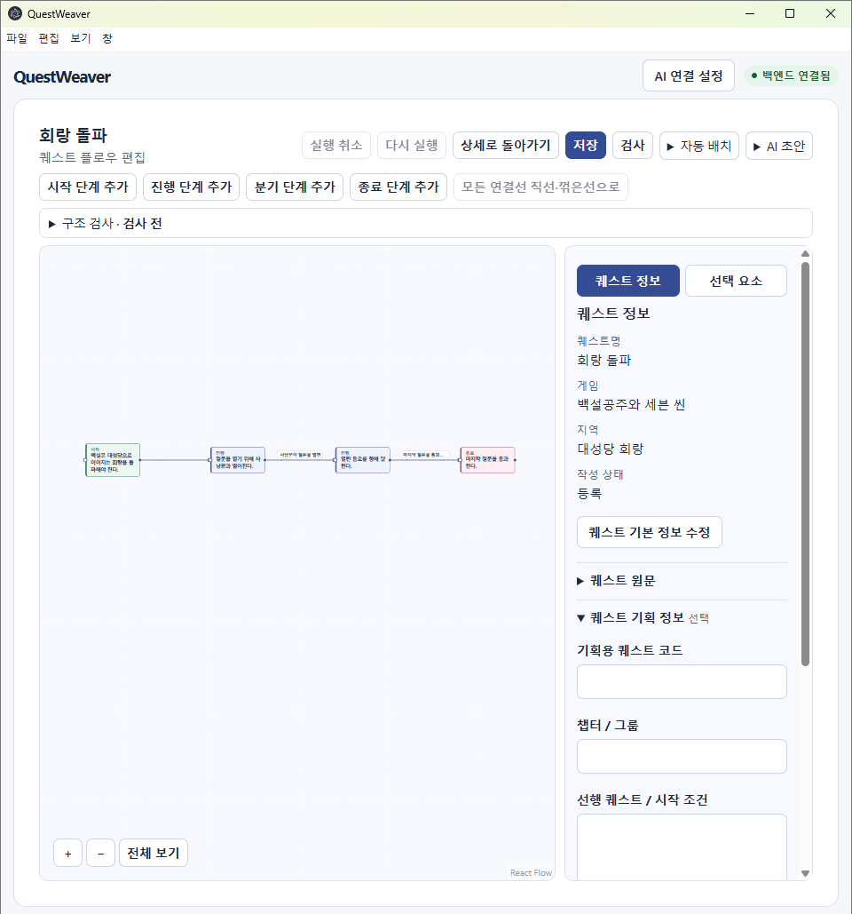
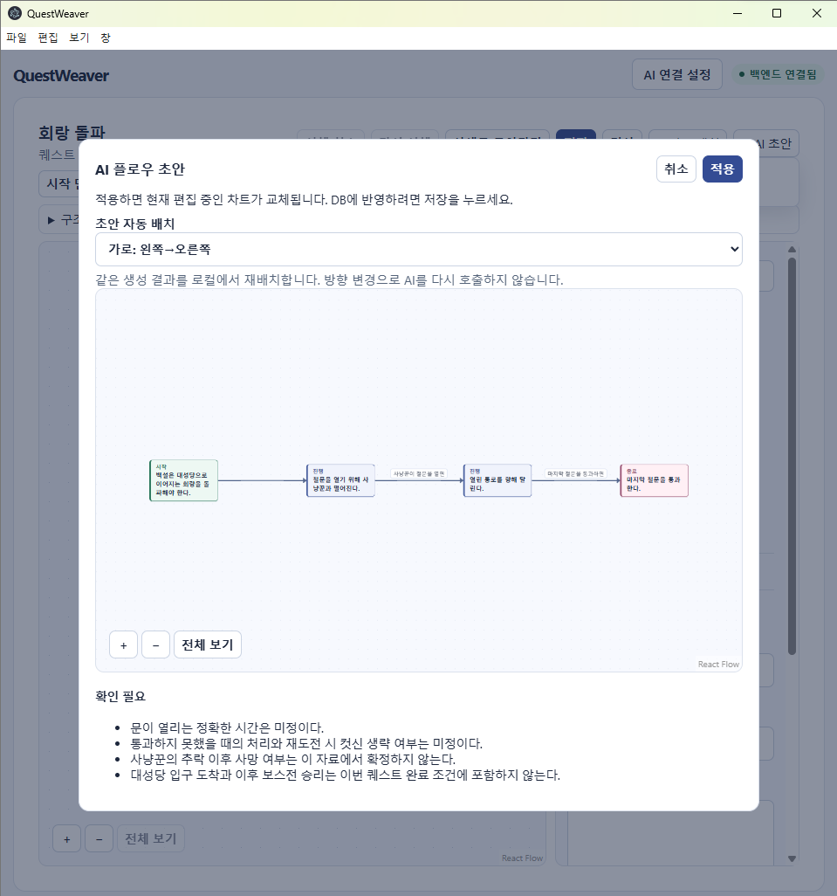

# QuestWeaver

퀘스트 원문을 작성하고, AI 초안을 검토해 플로우 차트로 다듬는 **로컬 데스크톱 퀘스트 기획 도구**입니다.

AI 없이도 퀘스트와 차트를 직접 작성·편집할 수 있습니다. 로그인 없이 이 PC에 작업을 저장합니다.

## 주요 기능

### 퀘스트 관리

퀘스트를 작성·수정하고 제목으로 검색합니다. 게임·지역별 필터로 작업을 찾고, 미완성 내용은 임시저장할 수 있습니다.

### 플로우 편집

시작·진행·분기·종료 단계와 연결선을 편집하고, 퀘스트 공통 정보와 단계별 기획 정보를 작성합니다.

- 단계 박스 크기와 연결 방향, 직선·꺾은선·곡선 경로 조절
- 실행 취소·다시 실행과 미저장 이탈 확인
- AI를 호출하지 않는 가로·세로 자동 배치

위 화면은 **AI 초안을 편집기에 적용한 예시**입니다. 직접 작성한 차트도 같은 편집 기능을 사용합니다.

### AI 초안 생성

**저장된 원문 → AI 초안 미리보기 → 검토·적용 → 저장** 순서로 진행합니다. 불명확한 내용은 ‘확인 필요’ 항목으로 확인하며, 적용만으로는 저장되지 않습니다.

AI 결과는 사람이 검토하고 수정할 **초안**입니다.

### 구조 검사와 파일 출력

차트의 연결 누락·도달 불가·종료 경로 등을 검사합니다. 검사는 **연결 구조**를 대상으로 하며, 게임 실행이나 자유 입력한 조건·변수의 의미까지 검증하지 않습니다.

- **PNG 내보내기**: 저장된 전체 차트를 이미지로 저장
- **JSON 내보내기·가져오기**: 원문·기획 정보·차트를 백업하고 다른 PC로 이동

JSON은 기존 퀘스트를 덮어쓰지 않고 새 임시저장 항목으로 가져옵니다.

## 실행 방법

[QuestWeaver v1.0.0 다운로드](https://github.com/Jmin0613/QuestWeaver/releases/tag/v1.0.0)에서 Windows x64 설치 파일과 SHA-256 확인 파일을 받을 수 있습니다.

1. `QuestWeaver.Setup.1.0.0.exe`를 다운로드합니다.
2. 설치 파일을 실행해 설치합니다.
3. Windows 시작 메뉴에서 **QuestWeaver**를 검색해 실행합니다.

Windows x64용이며, 별도의 Java·Node.js 설치는 필요하지 않습니다. 코드 서명이 없어 Windows 실행 경고가 나타날 수 있으니 배포 출처와 SHA-256을 확인하세요.

AI를 사용하려면 상단 **AI 연결 설정**에서 본인의 [OpenAI API 키](https://platform.openai.com/api-keys)를 등록합니다. AI는 선택 기능이며, 생성 시 저장된 퀘스트 원문이 OpenAI로 전송되고 API 요금은 본인 계정에 별도로 청구됩니다. ChatGPT 구독과 API 과금은 별개입니다.

화면의 샘플 퀘스트는 사용 예시이며 설치 파일에 포함되지 않습니다. 신규 사용자는 빈 목록에서 시작합니다.

## 개발자 안내

개발 실행·테스트·빌드와 상세 동작은 [개발 문서](docs/development.md)를 참고하세요.
