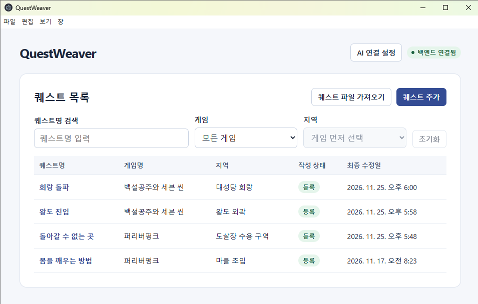
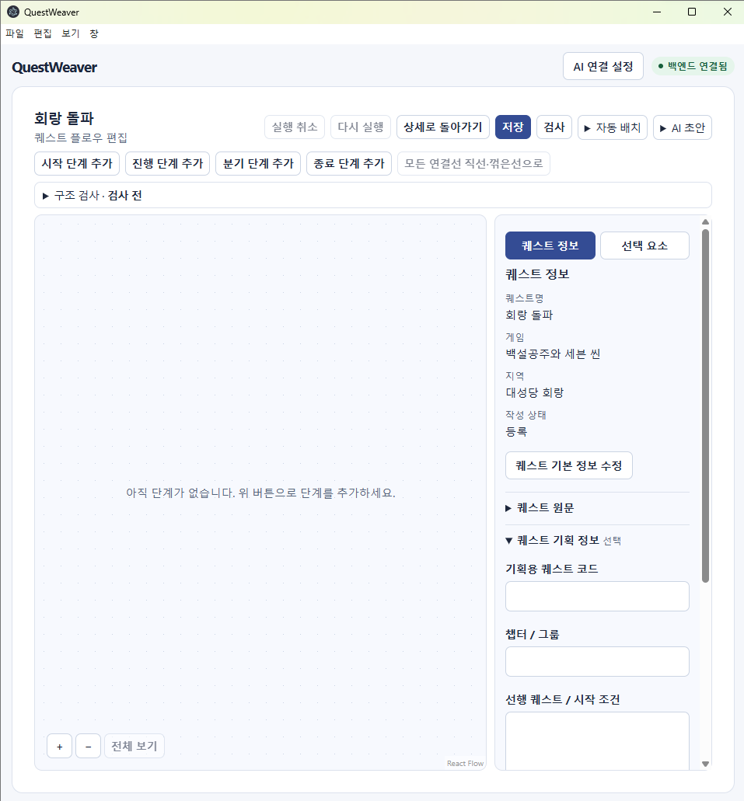
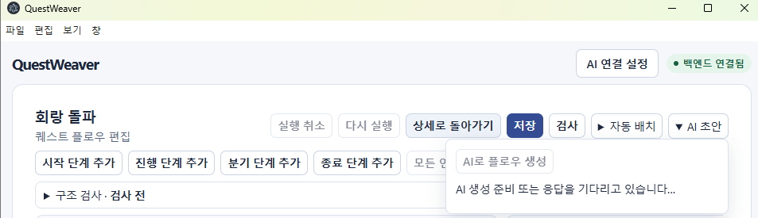

# QuestWeaver

퀘스트 원문을 작성하고, AI 초안을 검토해 플로우 차트로 다듬는 로컬 데스크톱 퀘스트 기획 도구입니다.

기획자가 이야기의 진행·분기·반복 경로를 한 화면에서 정리하고, 연결 구조를 확인하며 기획 정보를 함께 보관하기 위해 만들었습니다. 로그인이나 계정 서버 없이 이 PC에 작업을 저장합니다. 작성자 이름은 선택 입력하는 표시 정보이며 소유권이나 접근 권한을 나누지 않습니다.

## 주요 화면

### 퀘스트 목록



### AI 플로우 초안 미리보기


화면의 퀘스트는 사용 예시입니다. 샘플 원문·JSON·DB는 설치 파일에 포함되지 않으며, 신규 사용자는 빈 목록에서 시작합니다. 기존 사용자의 작업은 유지됩니다.

<details>
<summary>AI 초안 생성부터 편집기 적용까지</summary>

1. 저장된 퀘스트에서 플로우 편집기를 엽니다.



2. **AI 초안 → AI로 플로우 생성**을 선택하고 원문 전송을 확인합니다.


3. 생성 응답을 기다립니다.



4. 미리보기와 확인 필요 항목을 검토한 뒤 적용합니다. **저장**을 눌러야 DB에 반영됩니다.


</details>

## 다운로드·설치 방법

**v1.0.0은 공개 준비 중이며 아직 다운로드를 제공하지 않습니다.** 공개 후 [GitHub Releases](https://github.com/Jmin0613/QuestWeaver/releases)에 Windows x64 NSIS 설치 파일을 게시할 예정입니다.

설치 파일명은 `QuestWeaver Setup 1.0.0.exe`입니다. Java 런타임과 Electron을 포함하므로 사용하는 PC에 Java나 Node.js를 별도로 설치할 필요가 없습니다. 기본 설치는 현재 Windows 사용자 기준입니다. 이번 준비 빌드는 코드 서명되지 않았습니다. Windows 보안 경고가 나타날 수 있으며, 출처와 공개된 SHA-256을 확인하세요.

현재 자동 검증 환경과 실제 설치 검증의 차이는 [v1.0.0 검증 기록](docs/release-validation-v1.0.0.md)에 정리했습니다. 별도 Windows 사용자에서의 실제 설치·시작 메뉴 실행은 공개 전에 확인해야 합니다.

## 주요 기능

- 게임·지역별 퀘스트 작성, 수동 임시저장, 등록·수정·삭제와 제목 검색
- 퀘스트 공통 기획 정보와 단계별 행동·목표·조건·결과·메모 작성
- 시작·진행·분기·종료 단계, 분기·병렬·재도전 연결 편집
- 단계 크기·연결 방향, 직선·꺾은선과 곡선 경로 조절
- 실행 취소·다시 실행, 미저장 이탈 확인, 가로·세로 자동 배치
- Java 규칙 기반 그래프 구조 검사, 저장된 차트 미리보기와 PNG 내보내기
- OpenAI를 이용한 원문 구조화 초안과 확인 필요 항목 검토
- 퀘스트 JSON 파일 백업·이동·새 퀘스트로 가져오기

## 기본 사용 순서

1. **퀘스트 추가**에서 게임을 선택하거나 추가하고 제목과 원문을 작성합니다. 지역·작성자는 선택 사항입니다.
2. 미완성 내용은 **임시저장**, 게임·제목·원문을 채운 내용은 **등록**합니다.
3. 상세의 **플로우 편집**에서 단계를 직접 추가하거나 AI 초안을 생성합니다.
4. 단계와 연결선의 속성을 다듬습니다. 자동 배치는 명시적으로 실행할 때만 적용되며 기존 수동 경로를 초기화하기 전에 안내합니다.
5. **검사**로 구조상 경고를 확인합니다. 검사 전이거나 경고가 있어도 저장할 수 있습니다.
6. **저장** 후 상세 미리보기에서 확인하고 필요하면 PNG 또는 퀘스트 JSON을 내보냅니다.

**Ctrl+Z / Ctrl+Y**는 입력란 안에서는 텍스트 편집, 입력란 밖에서는 차트 이력을 처리합니다. 확대·화면 이동·선택은 차트 이력에서 제외됩니다. 저장 후에도 현재 편집 세션의 이력은 유지됩니다.

## AI 연결 설정과 비용·원문 전송 안내

상단 **AI 연결 설정**에서 본인의 OpenAI API 키를 등록·교체·삭제합니다. 현재 모델이 표시되며 기본값은 `gpt-5.4-mini`입니다. 키 저장만으로 생성하거나 유료 인증 테스트를 보내지 않습니다.

AI 생성 시 **저장된 퀘스트 원문이 OpenAI로 전송**됩니다. API 사용료는 해당 API 계정에 청구되며 ChatGPT 구독과 API 과금은 별개입니다. 실제 생성 전에 전송 확인을 거칩니다. [API 키 발급 페이지](https://platform.openai.com/api-keys)

- **이 PC에 키 저장**은 기본 해제이며, 해제하면 이번 앱 실행 동안만 사용합니다.
- 체크하면 운영체제 보안 저장 기능으로 암호화합니다. 안전한 저장이 불가능하면 평문 저장 대신 세션 전용을 안내합니다.
- PC 저장 키를 세션 전용 키로 교체하면 이전 보관 키도 제거합니다. 저장된 키 원문은 다시 표시하지 않습니다.
- 앱 등록 키가 개발 환경변수보다 우선합니다. 앱 키 삭제 후 환경변수가 남으면 **개발 환경변수 사용 중**으로 표시합니다.
- 키 없이도 작성·편집·검사·저장·JSON·PNG 기능을 사용할 수 있습니다.

AI 결과는 사람이 검토·수정하는 **초안**입니다. 미리보기에서 적용해도 자동 저장하지 않습니다. 실패·취소 시 기존 편집 내용을 유지하며 자동 유료 재시도는 하지 않습니다.

## JSON 내보내기·가져오기

상세의 **퀘스트 파일 내보내기**로 저장된 한 건을 UTF-8 JSON으로 백업합니다. 원문·작성자·게임·지역·기획 정보·단계와 연결·크기·배치·경로·보기 상태를 포함하며, 내보내기로 수정일이 바뀌지 않습니다. 미저장 편집은 먼저 저장하세요.

목록의 **퀘스트 파일 가져오기**에서 파일을 고르고 내용을 확인한 뒤 **새 퀘스트로 가져오기**를 누릅니다. 기존 항목을 덮어쓰지 않고 새 ID의 **임시저장**으로 생성합니다. 같은 파일을 다시 가져오면 별도 항목이 됩니다. 게임·지역은 중복 방지 규칙에 따라 재사용합니다.

버전 1 형식(`questweaver.quest`), 5 MiB 이하, 단계 2,000개·연결 5,000개 이하를 지원합니다. 손상된 참조나 미지원 버전은 오류로 안내하지만, 미완성 차트의 구조 경고 때문에 가져오기를 막지는 않습니다. 가져오기는 AI를 호출하지 않습니다.

API 키·보안 설정·인증 토큰·로그·PC 경로는 자동 수집해 넣지 않습니다. 원문·메모에 직접 쓴 민감한 내용은 JSON에 그대로 들어가므로 공유 전에 확인하세요. 전체 DB 일괄 백업이나 파일 암호화 기능은 없습니다.

## 알려진 한계

- 구조 검사는 시작·종료·도달 가능성·막힌 진행·분기 조건 유무 등 **그래프 연결 구조**를 확인합니다. 게임 실행이나 자유 입력한 조건·변수의 의미와 실제 충족 가능성까지 검증하지 않습니다.
- 자동 배치는 모든 교차·조건 문구 겹침을 없애지 않으므로 수동 보정이 필요할 수 있습니다. 큰 PNG는 이미지 크기 제한이 적용됩니다.
- 기존 수동 곡선은 단일 3차 베지어 표시 방식으로 인해 과거 버전과 모양이 일부 달라질 수 있습니다.
- 이 PC의 로컬 작업 도구이며 클라우드 동기화·협업·게임 엔진 연동·조건 실행은 제공하지 않습니다.
- 현재 준비 대상은 Windows x64입니다. 다른 OS 지원이나 별도 사용자 환경의 실제 설치 검증 완료를 보장하지 않습니다.
- 현재 빌드에 포함된 Java는 OpenJDK 21.0.2입니다. 정식 공개 전 최신 보안 업데이트가 적용된 Java 21로 재빌드·재검증이 필요합니다.

## 개발 실행·테스트·빌드 방법

Windows x64, Node.js 24 LTS와 Windows x64 JDK 21(`jlink`, `jmods` 포함)을 준비합니다. 프로젝트 루트의 PowerShell에서 실행합니다.

```powershell
$env:JAVA_HOME = 'C:\path\to\jdk-21'
cd desktop
npm.cmd ci
npm.cmd run dev
```

`dev`는 Java JAR과 화면을 빌드하고 Electron·백엔드를 함께 시작합니다. 백엔드를 수정한 뒤에는 개발 앱을 정상 종료하고 `npm.cmd run dev`를 다시 실행합니다.

```powershell
# 프로젝트 루트
cd backend
.\gradlew.bat test bootJar
cd ..
npm.cmd --prefix desktop run build
node --test desktop/tests/*.test.mjs
node desktop/tests/workspace.e2e.cjs
node desktop/tests/aiSettings.e2e.cjs
node desktop/tests/flowLayout.e2e.cjs
node desktop/tests/menu.e2e.cjs
node desktop/tests/questFiles.e2e.cjs

# Windows x64 NSIS 설치 파일 생성
cd desktop
npm.cmd run dist:win
```

설치 파일은 `desktop/release/`에 생성됩니다. 개발·설치 DB는 각각 `%APPDATA%\QuestWeaver-dev\data\questweaver.mv.db`, `%APPDATA%\QuestWeaver\data\questweaver.mv.db`로 분리됩니다. 처음 여는 프로필에만 빈 DB를 생성하며 기존 데이터를 초기화하지 않습니다. 백엔드는 127.0.0.1의 빈 포트에서 앱 전용 인증을 사용하고 앱 종료 시 함께 종료됩니다.

폴더 구조·테스트 방식·세부 조작·환경변수 설정은 [개발 문서](docs/development.md), 배포 후보 검증은 [검증 기록](docs/release-validation-v1.0.0.md), 공개 전 릴리즈 노트는 [v1.0.0 초안](docs/release-notes-v1.0.0.md)을 참고하세요.
